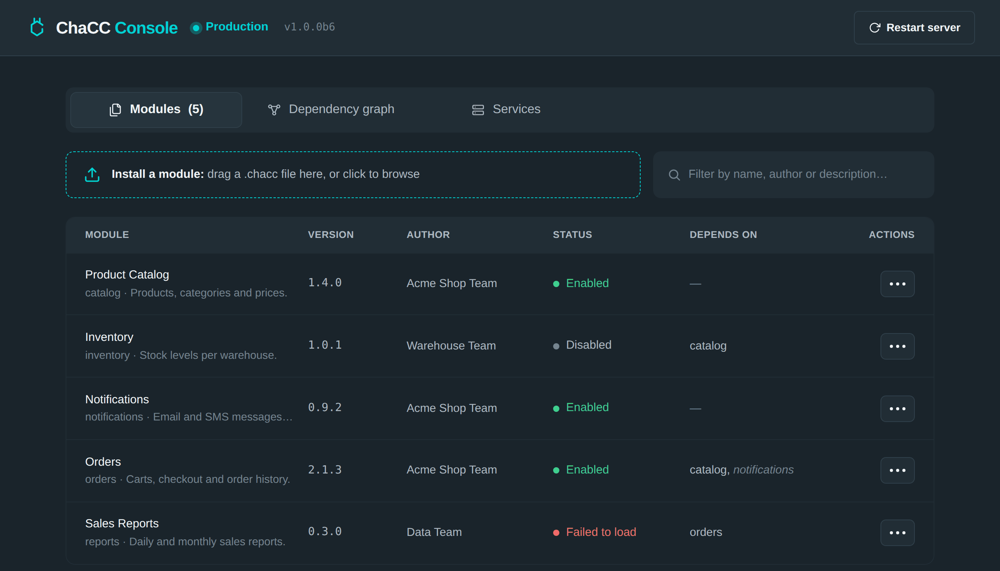
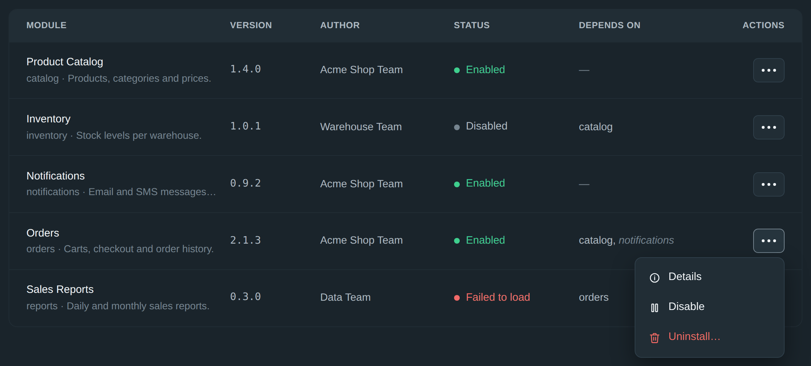
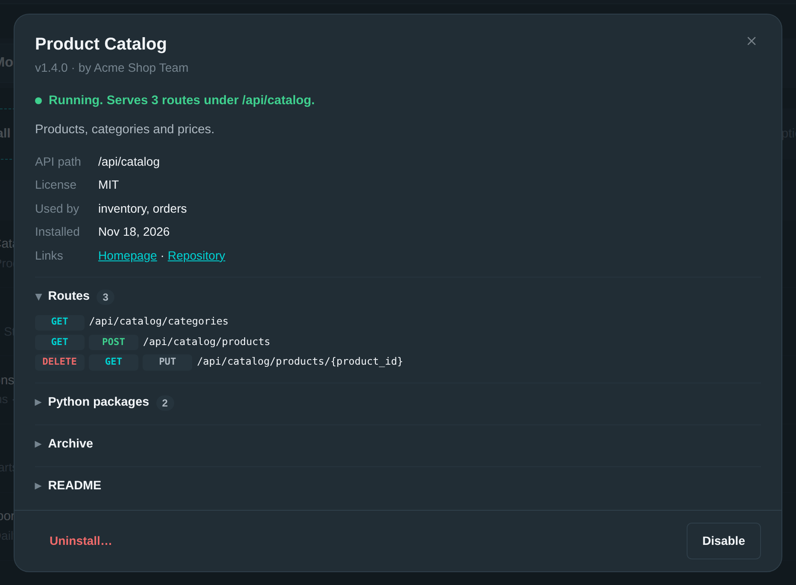
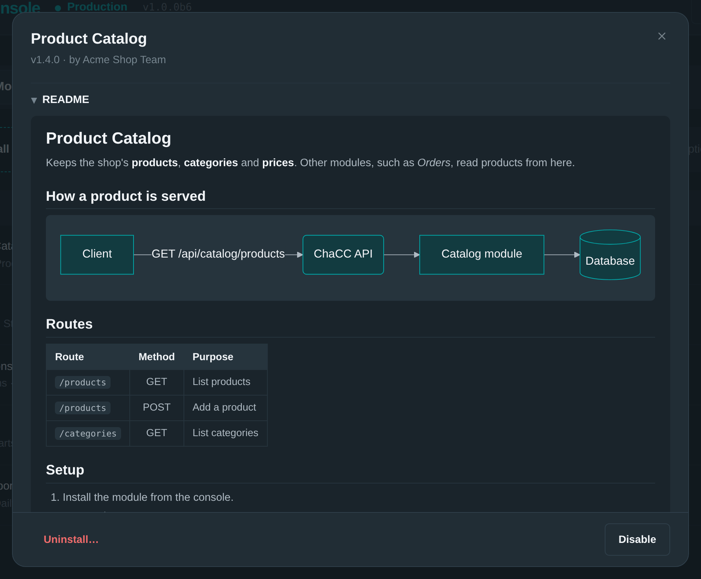
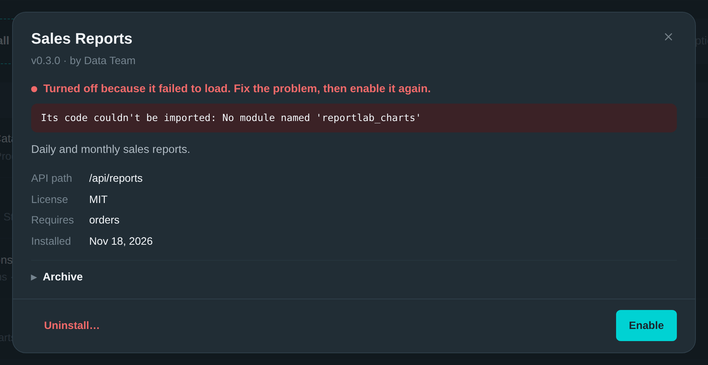
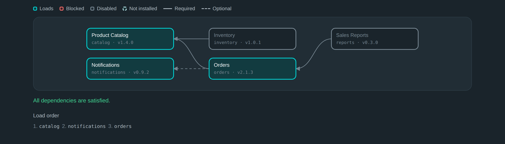
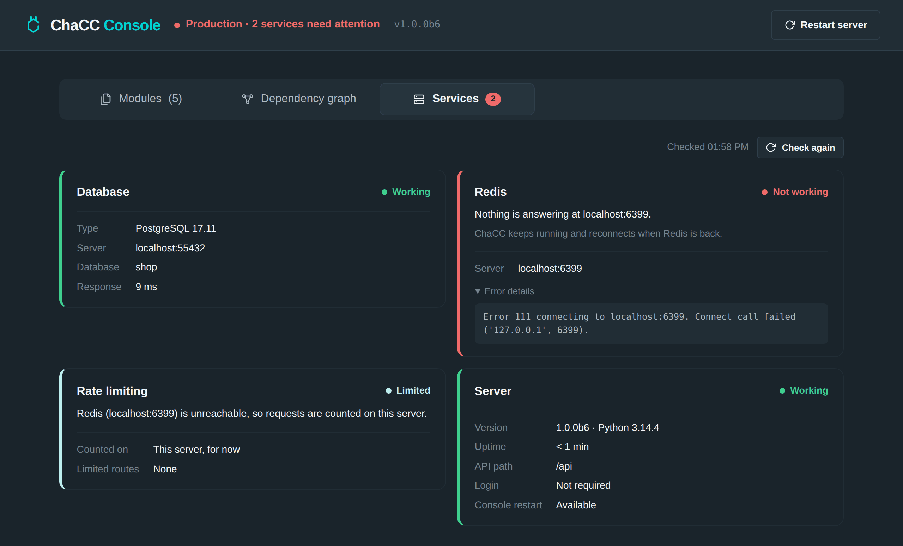

# Web Console

The web console is a page for managing a running server. Open `/console`, for
example `http://localhost:8085/console`.

## Who can use it

When the [authentication module](official-modules/authentication.md) is loaded,
the console asks you to log in, and only users with the console privilege or
`ALL` can use it. Other users see that their account can't manage the server.
The login lasts until you close the browser tab.

The console privilege is `MANAGE_WEB_CONSOLE`, or the name you set in
`CHACC_ADMIN_PRIVILEGE`. ChaCC registers it with the authentication module the
first time the console is opened, so you only need to give it to people. Use a
privilege that only grants the console.

The same rule protects what the console uses: the core module routes, the
services and restart, and so `chacc deploy`.

To give someone access, give them a role with the console privilege
(`PUT /rbac/users/{user_id}/roles`). If you change `CHACC_ADMIN_PRIVILEGE`
later, grant the new privilege: users with only the old one lose access.

Without the authentication module, the console is open to anyone who can reach
the server. To also limit it by address, see
[Behind a reverse proxy](deployment.md#behind-a-reverse-proxy).

## Modules

To install a module, drag its `.chacc` file onto the install area, or click it to
choose the file. Build the file with [`chacc build`](cli.md#build-a-module).

**Status** shows whether a module is on:

| Status | Meaning |
| --- | --- |
| Enabled | On. |
| Disabled | Off. |
| Failed to load | Turned off because it failed to start. Open its details to see why. |
| Not loaded | On, but a module it requires isn't installed. |

In **Depends on**, optional modules are in italics, and a module that isn't
installed is marked.

The **⋮** button on each row opens the module's actions:

Installing, enabling, disabling and uninstalling take effect after a restart. The
console then reminds you to restart. See [Restart the server](#restart-the-server).

## Module details

Click a module's name, or choose **Details** in its menu.

The popup shows:

- **State**, for example how many routes the module serves and where.
- **Facts** from `module_meta.json`: license, links, the modules it requires and
  the modules that use it, and the ChaCC version it needs.
- **Routes**, **Python packages** (with the installed versions), **Archive**
  (file, size and SHA-256) and **README**.

The README is shown as formatted Markdown, and `mermaid` code blocks are drawn as
diagrams. See [Module layout](modules.md#module-layout) for what module authors
can use.

When a module fails to start, its details say why:

In production the module stays off. Fix the problem, then enable it and restart.
The reason is kept across restarts until the module loads.

To share a module's details, use the link `/console#module=<name>`.

## Dependency graph

Each module is a box. Arrows point from a module to the modules it depends on;
dashed arrows are optional dependencies. A module that can't load is red, with
the reason and how to fix it below the graph. **Load order** is the order the
server loads the modules in.

## Services

The **Services** tab checks the database, Redis, rate limiting and the server.
It checks again every 30 seconds while the console is open, or when you click
**Check again**.

When a service is not working, or working with a fallback (**Limited**), the tab
shows a count and the top bar names the problem. Click the top bar to open the
tab. **Error details** has the original error. Passwords are never shown.

The same checks are available as [`GET /api/system/services`](core-api.md#service-status).

## Restart the server

**Restart server** in the top bar restarts the server and waits until it's back.
It needs the server to be started with `chacc run server`, and is off in
development mode, where the server reloads by itself. See
[Automatic Restarts](server-restarts.md).

## Development mode

In development mode the server loads modules from `plugins/`, while the module
list shows the modules installed in the database. The dependency graph shows
the modules in `plugins/`.
